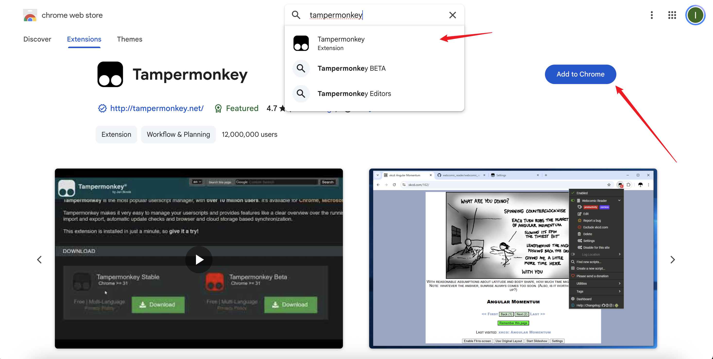
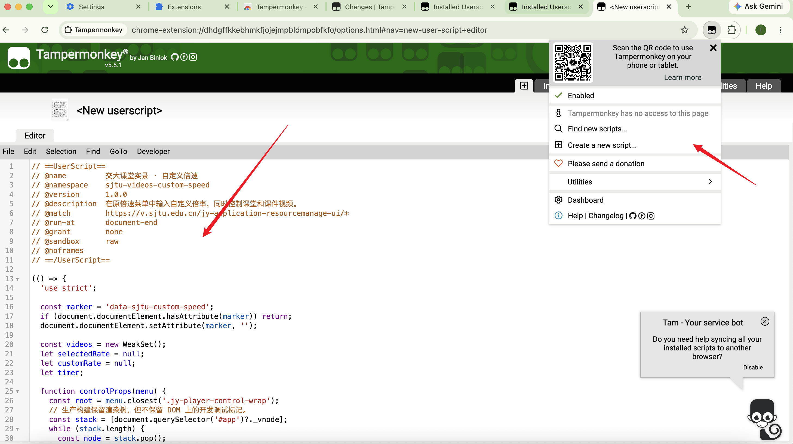
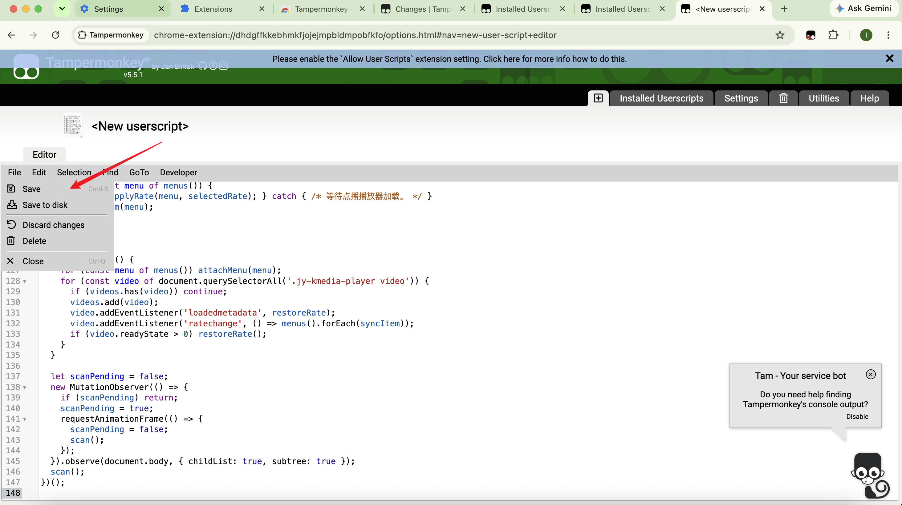
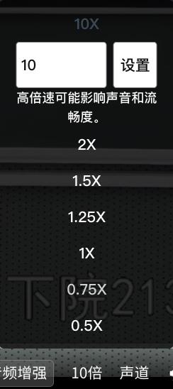

## 交大课程实录自定义倍速

### 作用范围

使用在 https://v.sjtu.edu.cn/jy-application-resourcemanage-ui/ 下的新版课程点播视频，即在 Canvas 的具体某个课程面板的「课堂视频新版」，可自定义倍速。

### 初衷

主要是因为课堂视频网站原始的设置只提供到最高 2x 的播放速度，如果边播放视频边按住键盘右方向键（→）则会是 3x，但是需要你一直按着右方向键。然后个人平时观看课程回放的时候在大部分地方喜欢使用 3x，如果一直按着右方向键个人使用体验很差，于是就开发了这个脚本。

### 配置与使用

1. 在浏览器的插件市场上下载 Tampermonkey 插件

这里以 Chrome 做演示

2. 授权浏览器可以使用脚本

详见 https://www.tampermonkey.net/faq.php?q=Q209#Q209

3. 在 Tampermonkey 创建相关脚本

在浏览器右上角点击 Tampermonkey 插件图标，再点击 **Create a new script**，然后删除默认内容，把 [sjtu-videos-custom-speed.user.js](sjtu-videos-custom-speed.user.js) 的全部内容复制进 Editor 中

然后再 Save

4. 使用

刷新页面后，点开一个 Canvas 课程的「课堂视频新版」点播视频，都可以自定义配置播放倍速

